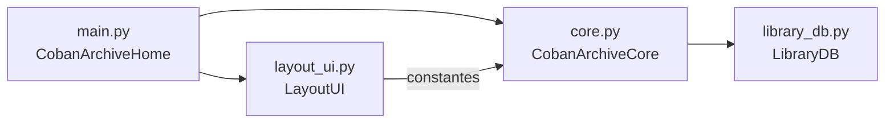
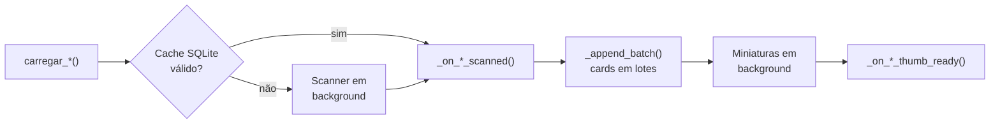

<div align="center">

# 🗂️ Coban Archive

**Gerenciador de biblioteca de músicas, CDs, vídeos, jogos e galeria de fotos.**


-41CD52?logo=qt&logoColor=white)


</div>

---

## 📑 Índice

- [Recursos](#-recursos)
- [Instalação e execução](#-instala%C3%A7%C3%A3o-e-execu%C3%A7%C3%A3o)
- [Formatos suportados](#-formatos-suportados)
- [Atalhos de teclado](#-atalhos-de-teclado)
- [Estrutura do projeto](#-estrutura-do-projeto)
- [Arquitetura](#-arquitetura)
- [Guia para desenvolvedores](#-guia-para-desenvolvedores)
- [Dados do aplicativo](#-dados-do-aplicativo)

---

## ✨ Recursos

| Página | O que faz |
|---|---|
| 🏠 **Início** | Tela inicial com atalhos para as bibliotecas. |
| 🎵 **Músicas** | Grade com capas ou lista só com nomes, playlist, aleatório e repetição (desligado / tudo / faixa). Busca por nome, artista ou álbum, e retoma a faixa de onde parou. |
| 💿 **CDs** | Cada pasta com áudio vira um álbum; a capa vem do primeiro áudio. |
| 🎬 **Vídeos** | Player com efeito retrô de TV (scanlines) e retomada da posição de cada vídeo. |
| 🎮 **Jogos** | Lista de ROMs com capa (imagem ao lado do arquivo). Abre com o programa padrão do sistema. |
| 🖼️ **Galeria** | Fotos ordenadas por data, até 5 pastas, visualização em tela cheia. |
| 🎚️ **Equalizador & Efeitos** | Página de ajustes de áudio. |
| ⚙️ **Configurações** | Tema, posição da barra lateral, modo de exibição das músicas, saída de áudio e pastas de cada biblioteca. |

**Também inclui**

- 🔎 **Busca global** em todas as bibliotecas (`Ctrl+K`).
- 🌗 **Tema claro e escuro** e barra lateral à esquerda ou à direita.
- ⚡ **Cache SQLite incremental:** só reprocessa o que mudou no disco.
- 🖼️ **Cache de miniaturas** gerado em background (a interface não trava).
- 👀 **Monitoramento de pastas:** detecta mudanças automaticamente.
- 🧭 **Assistente de primeira execução** e ícone na **bandeja do sistema**.
- 📝 **Log com rotação** para facilitar o diagnóstico.

> 💡 Se algum ícone da pasta `assets/` estiver ausente, o app usa um emoji no lugar e continua funcionando.

---

## 🚀 Instalação e execução

**Requisitos:** Python 3.9 ou superior.

```bash
# 1. Clone o repositório
git clone https://github.com/jairocesarzs/Coban-Archive.git
cd Coban-Archive

# 2. (Opcional) crie um ambiente virtual
python -m venv .venv
# Windows: .venv\Scripts\activate   |   Linux/macOS: source .venv/bin/activate

# 3. Instale as dependências
pip install PySide6 Pillow mutagen

# 4. Execute
python main.py
```

| Dependência | Uso | Obrigatória |
|---|---|:---:|
| `PySide6` | Interface (Qt) e reprodução de áudio/vídeo | ✅ |
| `Pillow` | Processamento de imagens | ✅ |
| `mutagen` | Leitura de tags (título, artista, álbum) e capas embutidas | ➖ opcional |

> Sem o `mutagen` o app funciona, mas a busca de músicas usa apenas o nome do arquivo.

---

## 📂 Formatos suportados

| Biblioteca | Extensões |
|---|---|
| 🎵 Áudio | `.mp3` `.ogg` `.m4a` `.wav` `.flac` |
| 🎬 Vídeo | `.mp4` `.mkv` `.avi` `.mov` `.wmv` `.webm` `.m4v` `.mpeg` `.mpg` `.ts` `.rm` `.rmvb` `.ram` `.rv` `.flv` `.3gp` `.vob` `.ogv` `.divx` |
| 🎮 Jogos | `.gba` `.ciso` |
| 🖼️ Imagens | `.png` `.jpg` `.jpeg` `.bmp` `.webp` |

Capas de jogos: `.png` `.jpg` `.jpeg` `.webp` com o mesmo nome da ROM, na mesma pasta (ou em uma subpasta).

---

## ⌨️ Atalhos de teclado

| Atalho | Ação |
|---|---|
| `Ctrl` + `Espaço` ou tecla **Play** | Tocar / pausar |
| `Ctrl` + `N` ou tecla **Próxima** | Próxima faixa |
| `Ctrl` + `B` ou tecla **Anterior** | Faixa anterior |
| `Ctrl` + `→` / `Ctrl` + `←` | Avançar / voltar na faixa |
| `Ctrl` + `↑` / `Ctrl` + `↓` | Aumentar / diminuir volume |
| `Ctrl` + `M` | Mudo |
| `Ctrl` + `F` | Focar no campo de busca (Músicas, Jogos e CDs) |
| `Ctrl` + `K` | Busca global |

---

## 🧱 Estrutura do projeto

```text
Coban-Archive/
├── main.py          # Ponto de entrada: log, QApplication e a janela final
├── core.py          # Lógica: constantes, scanners, workers, cache de miniaturas e regras
├── layout_ui.py     # Interface: widgets, páginas, cards, tema, diálogos e bandeja
├── library_db.py    # Banco SQLite da biblioteca (cache dos scans)
└── assets/
    ├── retro_tv_overlay.png
    └── icons/       # Ícones da interface e coban_archive_app.png
```

| Arquivo | Responsabilidade | Mexa aqui quando quiser… |
|---|---|---|
| `main.py` | Configura o log, cria o `QApplication` e junta UI + lógica em `CobanArchiveHome`. | mudar a inicialização do app |
| `core.py` | Tudo que **não é visual**: varredura de pastas, banco, miniaturas, player, configuração e atalhos de lógica. | mudar uma regra ou um comportamento |
| `layout_ui.py` | Tudo que **é visual**: layout das páginas, cards, estilos (QSS), temas, diálogos e menus. | mudar a aparência |
| `library_db.py` | Persistência SQLite (`existing_*`, `upsert_*`, `delete_*`, `record_scan`). | mudar o esquema do banco |

---

## 🏗️ Arquitetura

A janela principal é uma **composição**: a interface (`LayoutUI`) e a lógica (`CobanArchiveCore`) ficam em arquivos separados e são unidas em `main.py`.

```python
# main.py
class CobanArchiveHome(LayoutUI, CobanArchiveCore):
    ...
```



> `layout_ui.py` só importa **constantes** de `core.py`, então não há import circular.

### Fluxo de uma aba de mídia (músicas, CDs, jogos, galeria)



1. `carregar_*()` consulta o cache; se estiver válido, mostra direto.
2. Se não, uma thread varre as pastas **sem travar a interface**.
3. Os cards aparecem em lotes (botão **Carregar mais**).
4. As miniaturas chegam depois e são aplicadas em cada card.

---

## 🛠️ Guia para desenvolvedores

### Onde fica cada coisa em `layout_ui.py`

Procure pelos comentários de seção dentro da classe `LayoutUI`:

`Janela` → `Páginas` → `Cards das grades` → `Tema, ícones e estilos` → `Diálogos, menus e overlays` → `Bandeja do sistema`

### Helpers reutilizáveis

| Helper | Para quê |
|---|---|
| `_make_page(h, v)` | Cria uma página com margens. |
| `_make_path_toolbar(...)` | Barra com título, pasta atual e botão. |
| `_make_search_bar(...)` | Campo de busca com *debounce* de 250 ms. |
| `_make_scroll_grid(spacing)` | Área de rolagem com grade. |
| `_config_combo_row(...)` | Linha "rótulo + combo" da tela de Configurações. |
| `_create_btn(texto, kind)` | Botão estilizado (`primary`, `info`, `success`, `warning`…). |

### Adicionando uma nova aba de grade

As abas de grade compartilham o mesmo fluxo, descrito pela tabela `_GRID_TABS` em `core.py`. Para criar uma nova:

1. Adicione uma entrada em `_GRID_TABS` (nomes dos atributos, lote, colunas, mensagens).
2. Crie `carregar_<aba>()` com a thread de varredura da aba (`ScannerThread` ou uma subclasse de `_BaseScanner`).
3. Crie `_on_<aba>_scanned()`, `_card_for_<aba>()` e `_on_<aba>_thumb_ready()`.
4. Em `layout_ui.py`, crie o `_build_<aba>_card()` e a página (use `_make_scroll_grid`).

> ℹ️ `_on_<aba>_scanned` e `_card_for_<aba>` são chamados pelo **nome** (`getattr` com `f"..."`), por isso parecem "não usados" em buscas de texto.

### Varreduras (`_BaseScanner`)

`ScannerThread` e `CDScannerThread` herdam de `_BaseScanner`, que cuida de percorrer as pastas, respeitar o cancelamento e atualizar o cache SQLite gravando **só o que mudou**. Cada subclasse define apenas o que é específico (`_full_scan`, `_scan_current`, `_results`).

---

## 💾 Dados do aplicativo

Os arquivos ficam na pasta de dados do usuário (`QStandardPaths.AppDataLocation`):

| Arquivo | Conteúdo |
|---|---|
| `config.json` | Configurações, pastas, progresso de faixas/vídeos e última página aberta |
| `library.db` | Cache SQLite da biblioteca |
| `thumbnails/` | Cache de miniaturas |
| `coban_archive.log` | Log do aplicativo (rotativo, até 2 MB × 3 arquivos) |

---

<div align="center">

Feito com ❤️ e **PySide6** · [Repositório](https://github.com/jairocesarzs/Coban-Archive)

</div>
